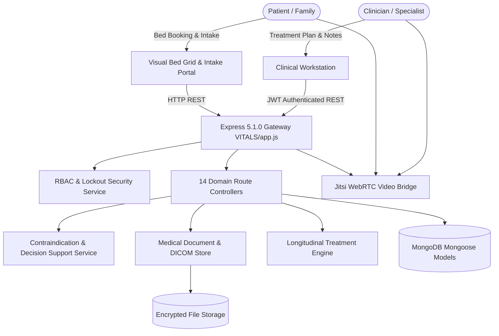

# Full Project Analysis: Sachidanand Health Care (VITALS)

## 0.1 What the Project Is
**Sachidanand Health Care (VITALS)** is a zero-friction, integrated hospital management and clinical operating system engineered to eliminate administrative opacity and fragmentation across the entire patient care continuum.

It unifies hospital administration, clinical decision support (CDSS), medical imaging metadata, visual ward resource allocation, real-time vital alerts, gamified post-stroke physical rehabilitation, and e-pharmacy logistics into a unified, secure platform.

### Target Personas
1. **Hospital Administrators & Ward Heads**: Managing real-time occupancy across General, Private, and ICU beds via a visual cinema-style allocation grid.
2. **Clinicians & Specialists**: Reviewing patient intake, longitudinal treatment plans, and automated drug-allergy contraindication warnings.
3. **Patients & Families**: Checking upfront surgical costs via dynamic insurance estimators, accessing live 6-hour vital health journals, attending remote Jitsi video consults, and ordering verified medications.

## 0.2 Architecture Flow

## 0.3 Final Inventory Counts
- **Total Frontend Views**: 24+ HTML5/JS responsive portals and clinical modules.
- **Core Domain Routes**: 14 Express route modules (`patientRoutes`, `clinicalRoutes`, `decisionSupportRoutes`, etc.).
- **Mongoose Data Models**: 49 schemas spanning EMR, imaging, audit, and hospital operations.
- **Automated Test Suites**: 13 test suites utilizing `node --test`, `supertest`, and `mongodb-memory-server`.
- **Security Checkpoints**: Dual-layer JWT + Session auth, bcrypt salt rounds, IP lockout protection, virus scan status validation.
