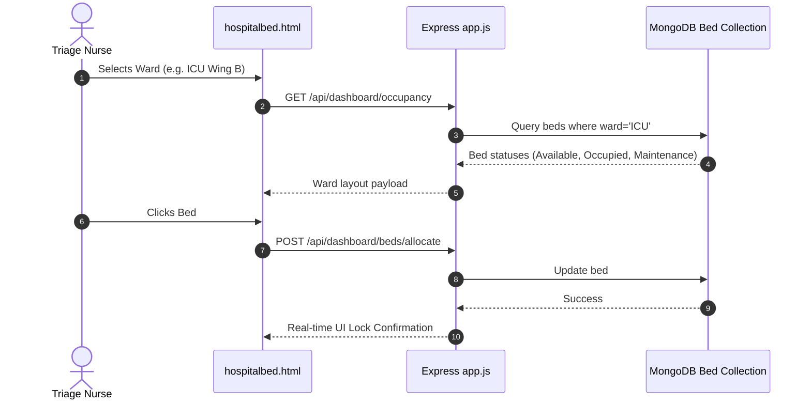
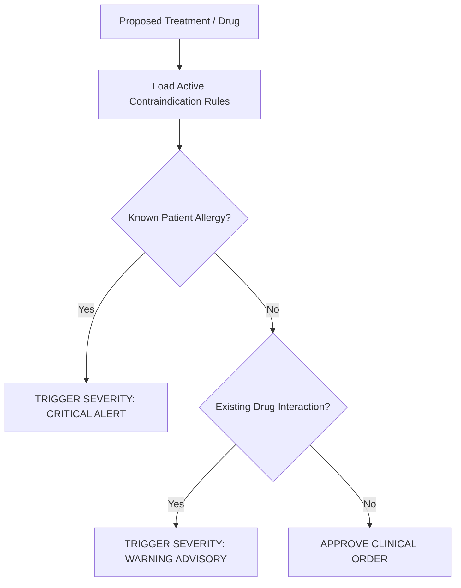

# Feature Inventory & Architectural Traces

## Core Feature Overview

| ID | Feature Name | Core Files & Functions | Description |
|---|---|---|---|
| **F1** | Visual Bed Allocation Grid | `hospitalbed.html`, `dashboardRoutes.js` | Cinema-style real-time bed selection and ward occupancy tracker. |
| **F2** | Clinical Decision Support & Contraindications | `decisionSupportRoutes.js`, `ContraindicationRule.js` | Real-time drug-allergy and procedure conflict evaluation engine. |
| **F3** | Surgical Bill & Insurance Estimator | `insurance.html`, `script.js` | Transparent pre-admission financial breakdown with deductibles. |
| **F4** | Multi-Tenant Document & DICOM Store | `documentRoutes.js`, `Document.js`, `ImagingMetadata.js` | Medical file registry with SHA-256 checksums and virus scanning checks. |
| **F5** | Gamified Rehab & Jitsi Telehealth | `xyzgame.html`, `videoconsultation.html` | Web-based motor recovery exercises and WebRTC video consultations. |

---

## F1: Visual Bed Allocation Grid
Allows triage nurses and admissions coordinators to view interactive 2D ward layouts (General, Semi-Private, ICU) and allocate beds with instant status locking.

### Say It Out Loud
> "I developed the visual bed allocation grid to replace chaotic whiteboard tracking in emergency admissions. In `hospitalbed.html` and `dashboardRoutes.js`, triage nurses can view a real-time, cinema-style floor map of all hospital beds across ICU, general, and private wards. Clicking any vacant bed immediately locks it and assigns the patient intake record in MongoDB, preventing accidental double-bookings during critical admissions."

---

## F2: Clinical Decision Support & Contraindications
Evaluates active prescriptions and proposed treatments against codified medical contraindication rules.

### Say It Out Loud
> "To safeguard patients against medical errors, I built the Clinical Decision Support engine in `decisionSupportRoutes.js`. When a physician inputs a new prescription or clinical intervention, the system queries `ContraindicationRule.js` against the patient's history. If an interaction with an existing medication or a recorded allergy is detected, the API flags a critical alert with clinical reasoning before the order can be finalized."

---

## F3: Surgical Bill & Insurance Estimator
Provides patients and families with upfront financial clarity before admission by calculating procedure costs, room charges, and insurance coverage.

### Say It Out Loud
> "Hospital billing is notoriously opaque, so I created the surgical bill calculator in `insurance.html`. Patients can select their surgical procedure, expected length of stay, and insurance policy details. The client-side logic calculates estimated room rents, surgeon fees, and co-pay deductibles, providing an honest, itemized estimate before any paperwork is signed."

---

## F4: Multi-Tenant Medical Document & DICOM Store
Registers and tracks diagnostic reports, consent forms, and MRI/CT imaging studies with integrity checksums and multi-tenant isolation.

### Say It Out Loud
> "For managing high-resolution scans and lab results, I engineered the document store in `documentRoutes.js`. Every diagnostic file uploaded is recorded with its SHA-256 checksum, MIME type, and virus scan status, linked to tenant and patient IDs in MongoDB. This ensures files cannot be tampered with and strictly enforces HIPAA-compliant audit trails."

---

## F5: Gamified Rehab & Jitsi Telehealth
Integrates browser-based stroke motor therapy and encrypted remote video consultations for post-operative follow-up.

### Say It Out Loud
> "To support patients after discharge, I integrated Jitsi Meet in `videoconsultation.html` for one-click encrypted video visits without requiring third-party software. Alongside it, in `xyzgame.html`, I built an interactive web-based motor recovery exercise that prompts stroke rehabilitation patients to perform hand-eye coordination challenges, tracking adherence directly in their medical profile."
