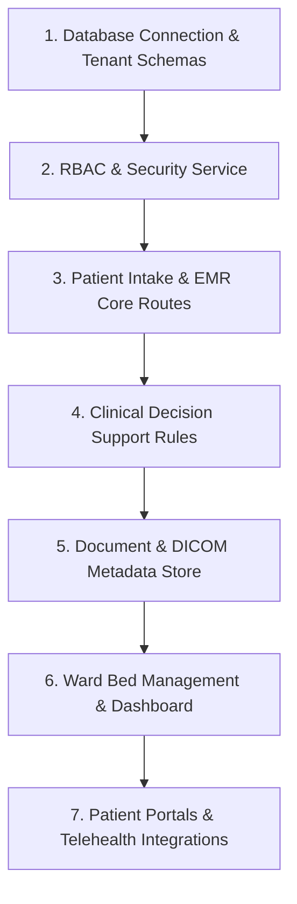

# Build Order: Reconstructing the VITALS Healthcare Platform

## Step-by-Step Build Order

1. **Database & Core Models**: Initialize Mongoose schemas for User, Patient, Document, and Bed collections.
2. **Security & Session Service**: Implement `securityService.js` with bcrypt, JWT access/refresh tokens, and failed login lockout.
3. **Clinical Core Routes**: Mount `patientRoutes.js` and `clinicalRoutes.js` for intake, longitudinal history, and vital tracking.
4. **Decision Support Engine**: Develop `decisionSupportRoutes.js` with rule evaluation against drug contraindications.
5. **Document Store**: Build `documentRoutes.js` with checksum auditing and virus scan flags.
6. **Ward Bed Allocation**: Expose `dashboardRoutes.js` and build `hospitalbed.html` visual grid.
7. **Patient Facing Portals**: Connect Jitsi WebRTC telehealth and financial calculators.
