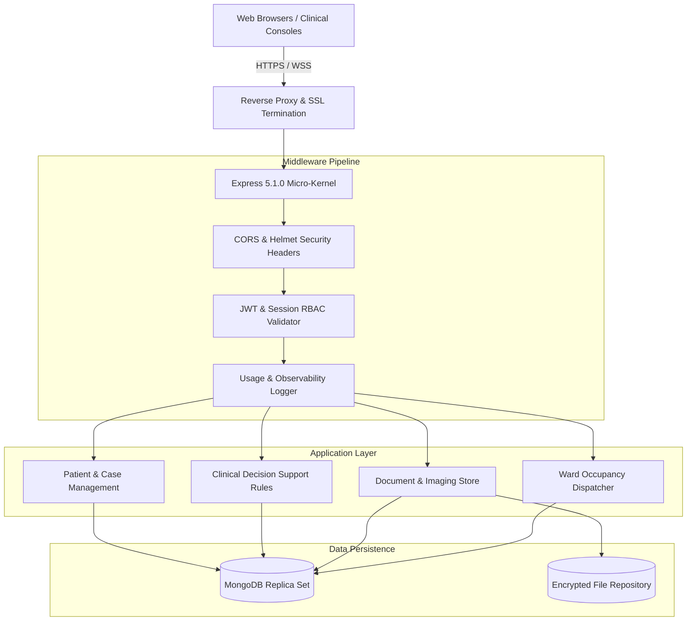

# Architecture & System Design: VITALS

## System Architecture

## Multi-Tenancy & Data Isolation
Every Mongoose query automatically scopes queries to `tenantId` (e.g., `tenantId: 'default'`), preventing cross-hospital data leakage in shared database deployments.
