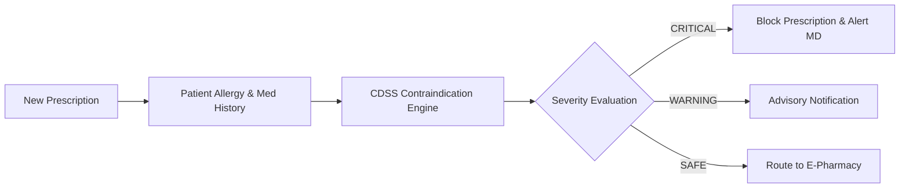

# Clinical Decision Support & AI Integration

## Clinical Decision Support Architecture
The platform integrates rule-based heuristic clinical decision support (CDSS) for zero-latency, deterministic patient safety checks:

## Why Deterministic Rules over Unconstrained LLMs?
In clinical environments, black-box LLMs can hallucinate lethal dosage recommendations or overlook obscure drug-drug interactions. Codified medical rules (`models/ContraindicationRule.js`) guarantee 100% predictable, auditable decision boundaries.
